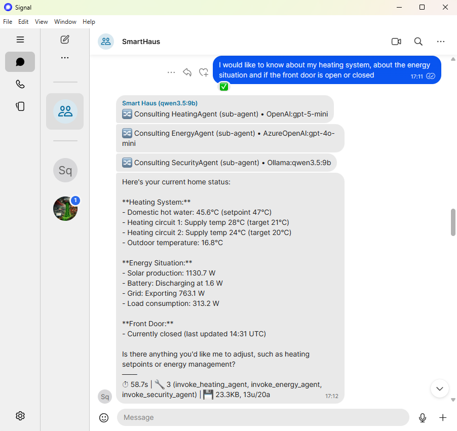
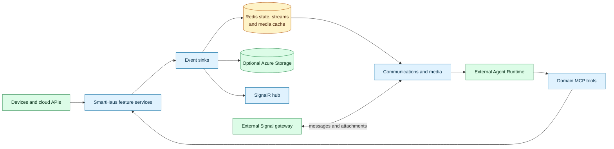

# SmartHaus

SmartHaus is an open-source .NET 10 smart-home and IoT application for edge hosts. It connects
heating, solar, KNX building automation, cameras, lighting and appliance APIs to event sinks,
versioned HTTP endpoints and Model Context Protocol (MCP) tools for AI agents.

[](https://sonarcloud.io/dashboard?id=f2calv_SmartHaus)

The application is an early proof of concept: interfaces may change and it is unsupported.
The standalone device libraries can also be used without running SmartHaus.



## Quick Start

With Docker and Compose installed:

The source-built demo uses the Release graph, resolving shared libraries, Agent Runtime contracts
and communications packages from NuGet. Debug source builds instead use the adjacent checkouts
listed in [Development](#development). This README does not report an executed demo.

```bash
git clone https://github.com/f2calv/SmartHaus.git
cd SmartHaus
docker compose --profile demo up --build
```

The demo builds the server and starts Redis, Azurite and OpenTelemetry infrastructure with
`EdgeHardware,Ubiquiti,Comms` enabled. Device/API exploration does not require a physical device or
Azure subscription; available CPU/GPU readings depend on the host and container access.
The communications feature additionally requires separately configured Agent Runtime and Signalizr
services. It is not a self-contained AI or messaging demo.

- [Swagger UI](http://localhost:8080/swagger) lists available HTTP endpoints.
- [System metadata](http://localhost:8080/api/system) identifies the running application.
- [REST Client requests](requests/README.md) include synthetic Ubiquiti webhook examples.

The [Compose definition](docker-compose.yml) owns dependency endpoints and the optional
hardware-specific speech profile; review its header before starting that profile.

For example, with the demo running, submit one synthetic camera event:

```bash
curl -X POST "http://localhost:8080/api/v1.0/ubiquiti/event/smart?type=person&camera_name=ExampleCamera&score=0.95"
```

The callback returns `ok` and dispatches the event to configured sinks. It does not imply that an
agent or Signal recipient is configured.

## Projects

The eight package listings below are published on NuGet; their source targets .NET 8 and .NET 10.
Other application libraries are source-only and target .NET 10. Each integration README describes
its own device, cloud authentication and configuration requirements.

| Integration | Client and usage | Optional storage sinks | Published packages |
| --- | --- | --- | --- |
| Buderus KM200 heating | [Client](src/CasCap.Api.Buderus/README.md) | [Redis, Azure Tables](src/CasCap.Api.Buderus.Sinks/README.md) | [Client](https://www.nuget.org/packages/CasCap.Api.Buderus), [sinks](https://www.nuget.org/packages/CasCap.Api.Buderus.Sinks) |
| DoorBird door stations | [Client](src/CasCap.Api.DoorBird/README.md) | [Redis, Azure Tables, Blob](src/CasCap.Api.DoorBird.Sinks/README.md) | [Client](https://www.nuget.org/packages/CasCap.Api.DoorBird), [sinks](https://www.nuget.org/packages/CasCap.Api.DoorBird.Sinks) |
| Fronius solar inverters | [Client](src/CasCap.Api.Fronius/README.md) | [Redis, Azure Tables](src/CasCap.Api.Fronius.Sinks/README.md) | [Client](https://www.nuget.org/packages/CasCap.Api.Fronius), [sinks](https://www.nuget.org/packages/CasCap.Api.Fronius.Sinks) |
| KNX building automation | [Client](src/CasCap.Api.Knx/README.md) | [Redis, Azure Tables, raw CEMI](src/CasCap.Api.Knx.Sinks/README.md) | [Client](https://www.nuget.org/packages/CasCap.Api.Knx), [sinks](https://www.nuget.org/packages/CasCap.Api.Knx.Sinks) |
| Edge CPU/GPU and GPIO | [Library](src/CasCap.Api.EdgeHardware/README.md) | [Redis, Azure Tables](src/CasCap.Api.EdgeHardware.Sinks/README.md) | Source only |
| Miele appliances | [Library](src/CasCap.Api.Miele/README.md) | [Redis, Azure Tables](src/CasCap.Api.Miele.Sinks/README.md) | Source only |
| Shelly smart plugs | [Library](src/CasCap.Api.Shelly/README.md) | [Redis, Azure Tables](src/CasCap.Api.Shelly.Sinks/README.md) | Source only |
| Sicce water pumps | [Library](src/CasCap.Api.Sicce/README.md) | [Redis, Azure Tables](src/CasCap.Api.Sicce.Sinks/README.md) | Source only |
| UniFi Protect webhooks | [Library](src/CasCap.Api.Ubiquiti/README.md) | [Redis, Azure Tables](src/CasCap.Api.Ubiquiti.Sinks/README.md) | Source only |
| WiZ lighting | [Library](src/CasCap.Api.Wiz/README.md) | [Redis, Azure Tables](src/CasCap.Api.Wiz.Sinks/README.md) | Source only |
| Azure Dynamic DNS | [Library](src/CasCap.Api.DDns/README.md) | Not an event-sink integration | Source only |
| Application hosts | [HTTP server](src/CasCap.App.Server/README.md), [agent console](src/CasCap.App.Console/README.md) | [Shared bootstrap](src/CasCap.App.Hosting/README.md) | [Container image](https://github.com/f2calv/SmartHaus/pkgs/container/smarthaus) |
| Application orchestration | [Backend, SignalR, communications, media and MCP](src/CasCap.Backend/README.md) | Redis streams and media cache | Source only |
| Helm charts | [Application](charts/smarthaus/README.md), [Grafana dashboards](charts/smarthaus-dashboards/README.md) | Configurable workload aliases and dashboard provisioning | `oci://ghcr.io/f2calv/charts/smarthaus` |
| Tests | [Buderus](src/CasCap.Api.Buderus.Tests/README.md), [DoorBird](src/CasCap.Api.DoorBird.Tests/README.md), [Fronius](src/CasCap.Api.Fronius.Tests/README.md), [KNX](src/CasCap.Api.Knx.Tests/README.md), [Miele](src/CasCap.Api.Miele.Tests/README.md), [host](src/CasCap.App.Server.Tests/README.md), [backend](src/CasCap.Backend.Tests/README.md) | Source-declared inventories and prerequisites | Not published |

## Compatibility

The 1.1 release intentionally includes incompatible contracts despite its minor version.
Rebuild package consumers and migrate the
[Buderus query-service write result](src/CasCap.Api.Buderus/README.md#migrating-to-11).
HTTP callers must also check the current typed device responses, string-enum JSON and
[validated Miele command bodies](src/CasCap.Api.Miele/README.md#commands-and-failures);
unrecognized Miele fields are rejected rather than forwarded.

## Use a Standalone Library

For a host application with configuration and logging, install a device client:

```bash
dotnet add package CasCap.Api.Fronius
```

Register the client and query its Solar API without starting continuous monitoring:

```csharp
using CasCap.Extensions;
using CasCap.Services;
using Microsoft.Extensions.DependencyInjection;
using Microsoft.Extensions.Hosting;

var builder = Host.CreateApplicationBuilder(args);
builder.Services.AddFronius(builder.Configuration, lite: true);
using var host = builder.Build();
var reading = await host.Services.GetRequiredService<FroniusClientService>()
    .GetPowerFlowRealtimeData();
```

Supply `CasCap:FroniusConfig` using the [Fronius configuration examples](src/CasCap.Api.Fronius/README.md#configuration-examples),
replacing synthetic values with the inverter's LAN endpoint. Other libraries expose their own
registration methods and contracts; full background monitoring needs the feature-worker runner,
not just a call to `AddHostedService`.

## Configuration

`CasCap:FeatureConfig:EnabledFeatures` selects a comma-separated set of features:
`Buderus,Comms,DDns,DoorBird,EdgeHardware,Fronius,Knx,Miele,Shelly,Sicce,SignalRHub,Ubiquiti,Wiz`.
Select only integrations you have configured; enabled device features may read or control real hardware.

The hosts load base and environment appsettings, local overrides, user secrets, environment variables
and optional Azure Key Vault through the shared bootstrap. See
[configuration initialization](src/CasCap.App.Hosting/README.md) for the provider contract.
Use gitignored local configuration or user secrets for credentials. Environment keys use double
underscores, for example `CasCap__FeatureConfig__EnabledFeatures=Ubiquiti`.

### Configuration Examples

This fragment selects webhook processing and disables Key Vault; merge it with the tracked
application configuration and [Ubiquiti settings](src/CasCap.Api.Ubiquiti/README.md#configuration-examples):

```json
{
  "AppConfig": { "KeyVaultName": "skip" },
  "CasCap": {
    "FeatureConfig": { "EnabledFeatures": "Ubiquiti" }
  }
}
```

Redis is a server prerequisite even for a single-process profile. Azure storage sinks and Key Vault
are optional capabilities; corresponding options may still require syntactically valid endpoints.
The local demo uses Azurite rather than an Azure subscription.

## Service Architecture

Feature services collect device readings or receive webhooks and dispatch events to selected sinks.
SignalR broadcasts events; Redis streams connect domain events and media to communications.
SmartHaus exposes its own MCP tools but does not construct or select language-model agents.



The [backend README](src/CasCap.Backend/README.md) documents Signal groups, speech-to-text providers,
media limits and tool registration. [Agent instruction examples](docs/agent-examples/README.md)
illustrate behavior only; active definitions, sessions, inference providers and credentials belong
to the external runtime.

## Development

Use a stable .NET 10 SDK. For the current source tree, the Debug solution uses sibling source
dependencies:

```bash
dotnet build SmartHaus.Debug.slnx --configuration Debug
```

These include the public
[CasCap.Common](https://github.com/f2calv/CasCap.Common) and
[CasCap.Api.Azure](https://github.com/f2calv/CasCap.Api.Azure) libraries,
[Signalizr communications](https://github.com/f2calv/signalizr) and
[Agent Runtime](https://github.com/f2calv/agentizr) projects, plus their transitive source references,
checked out alongside this repository.
`docker compose up` starts only local infrastructure; the `demo` profile also builds the server.
See the project test READMEs before choosing tests: some access live devices, cloud services or
change device state, and must not be treated as credential-free checks.

Device integration fixtures select the shared `Test` configuration environment, including optional
[appsettings.Test.json](appsettings.Test.json), local test overrides, User Secrets and environment
variables. The tracked test defaults use local dependencies; they do not supply real device access.
Put test-only private overrides in `appsettings.Local.Test.json`, not the Development tier.

## License

[MIT License](LICENSE).
