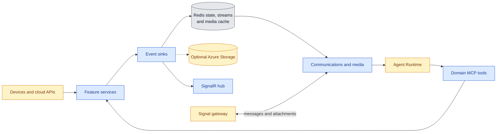
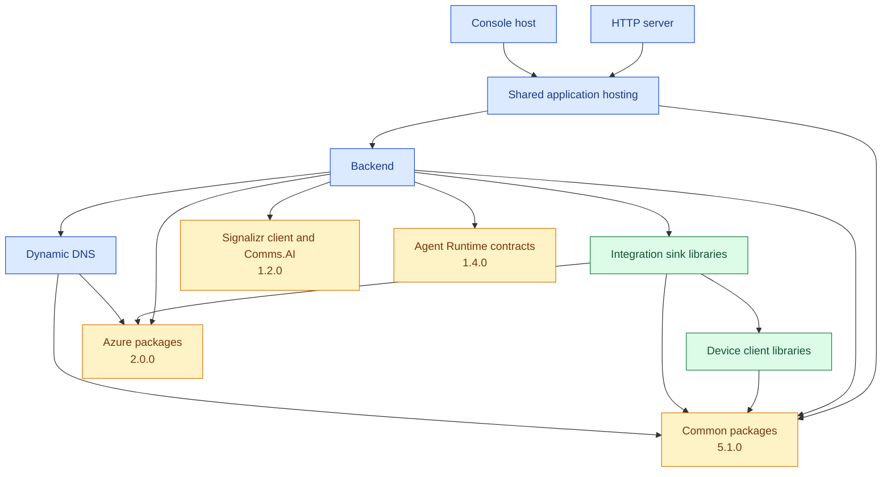

# Architecture

These source-derived views complement the [System Context](../README.md#system-context) and
the [backend component view](../src/CasCap.Backend/README.md#components). Workloads select
features from one application image; the [chart dependency graph](../charts/smarthaus/README.md#dependency-graph)
shows the separately configurable process aliases.

## Data Flow

Device features dispatch readings and webhook events to selected sinks. Redis connects event and
media producers to communications; the external runtime owns model execution and calls domain MCP tools.

## Dependency Graph

Release builds use verified Common 5.1.0, Azure 2.0.0, Signalizr 1.2.0 and Agent Runtime 1.4.0
packages. Debug uses adjacent source projects for those dependencies. Same-repository references
remain project references in both configurations.

The client/sink families include four published pairs: Buderus, DoorBird, Fronius and KNX.
Other integration families remain source-only, as listed in the [project catalogue](../README.md#projects).
Green nodes identify families containing published packages, not every integration's publication status.

## Workflow

The [publication flow](artifact-publication.md#deployment-flow) follows the actual CI and manual
artifact workflows. Neither publication nor a release tag establishes a live deployment.
