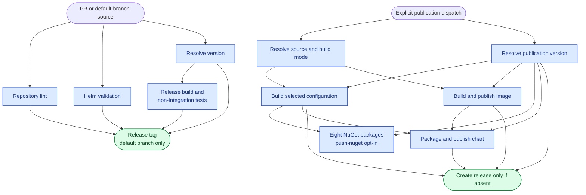

# Artifact Publication

SmartHaus publishes packages, a container image and a Helm chart through
[deploy-all](../.github/workflows/deploy-all.yml). This workflow does not deploy workloads.

## Deployment Flow

Pull requests validate without publishing. Default-branch CI creates the release tag after its
gates pass; the separate, explicitly dispatched publication workflow builds the image/chart and,
when requested, the eight NuGet packages.



The NuGet-only recovery path below skips versioning, the normal build, image/chart publication and
release tagging; it independently rebuilds the exact existing release source.

## Full Publication

Run the workflow from the default branch, with all sibling source-reference inputs empty, to
use the Release dependency graph. Enable `push-nuget` when publishing the eight device packages.
Stable NuGet publication from any other workflow ref fails explicitly.

Verify the calculated version and source commit against the immutable release before accepting
publication. Confirm every package through NuGet's restore endpoint, the image's platform-specific
version/revision labels, and the chart's version and application version.

Do not repeat full publication for an already-published version: image and chart tags must not be
replaced, even when another artifact is missing.

## Recover Missing NuGet Packages

For an existing stable GitHub release, run from the default branch and set `nuget-release` to its
exact unprefixed version:

```bash
gh workflow run deploy-all.yml --ref main -f nuget-release=1.2.3
```

This mode validates that the release exists and is neither a draft nor a prerelease, checks out
its tag, and builds the packages with that version and the tag's actual source revision.
It skips version calculation, the application build job, image/chart publication and release
tagging. Other publication and sibling source-reference inputs are ignored in this mode.
The package action independently restores and builds the release solution before packing.

The existing NuGet Trusted Publishing policy must authorize this repository's `deploy-all.yml`
workflow on the default branch. Authentication or publication failures must be resolved before
continuing. Verify all eight exact package versions through NuGet's restore endpoint; a green
workflow alone is not proof of availability. Existing packages are skipped, not replaced.
