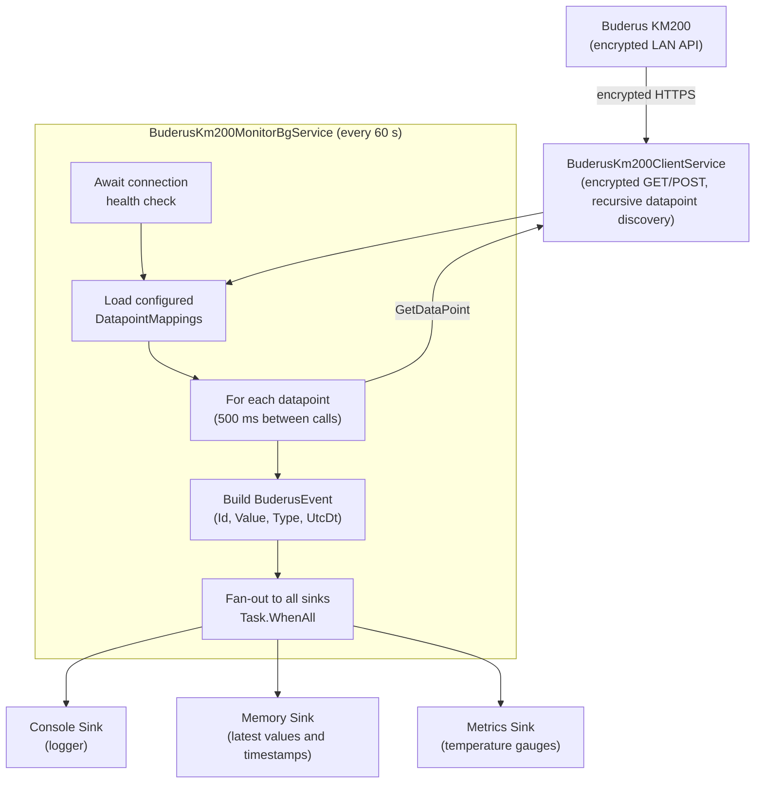

# CasCap.Api.Buderus

A .NET client library for the [Buderus](https://www.buderus.com) KM200 heat-pump controller's encrypted local HTTP API. Use it to read or write datapoints, or monitor configured datapoints through pluggable sinks.

## Installation

Targets .NET 8 and .NET 10.

```bash
dotnet add package CasCap.Api.Buderus
```

## Usage

Load the configuration below in a .NET host, then register and resolve the client:

```csharp
using CasCap.Extensions;
using CasCap.Services;
using Microsoft.Extensions.DependencyInjection;
using Microsoft.Extensions.Hosting;

var builder = Host.CreateApplicationBuilder(args);
builder.Services.AddBuderus(builder.Configuration, lite: true);
using var host = builder.Build();
var client = host.Services.GetRequiredService<BuderusKm200ClientService>();
var datapoint = await client.GetDataPoint("/dhwCircuits/dhw1/actualTemp");
```

`lite: true` omits monitoring and health checks for direct client calls. Full registration exposes
[`IBgFeature`](https://github.com/f2calv/CasCap.Common/blob/main/src/CasCap.Common.Abstractions/Abstractions/IBgFeature.cs) workers; a host must start them through `AddFeatureFlagService`, as SmartHaus does.
Reading requires the device's gateway and private passwords. Writing changes live heating settings.

## Monitoring

The library is built around one background service that forms the core pipeline:

**`BuderusKm200MonitorBgService`** waits for the device health check, then reads the keys in
`DatapointMappings` every `PollingIntervalMs` (60 seconds by default). It pauses for
`DatapointDelayMs` (500 ms) between reads and fans each `BuderusEvent` out to the registered sinks.
An empty mapping disables polling. Recursive discovery is available separately through
`BuderusKm200ClientService.GetAllDataPoints`; monitoring does not discover or filter datapoints.

A REST API (`BuderusController`) exposes endpoints for listing all current datapoint values, querying events by datapoint ID, and retrieving the latest snapshot.

Datapoint writes through
[`IBuderusQueryService`](https://github.com/f2calv/SmartHaus/blob/main/src/CasCap.Api.Buderus/Abstractions/IBuderusQueryService.cs)
return a `BuderusDataPointWriteResult` with `Succeeded` and an optional rejection `Error`.
The query service validates and normalizes the path; the controller maps the result to HTTP.
The MCP write tool continues to return a boolean. Reads, write preflight reads and recursive
discovery accept cancellation; cancellation propagates instead of returning partial discovery results.

### Migrating to 1.1

`IBuderusQueryService.SetDataPoint` now returns `Task<BuderusDataPointWriteResult>` instead of
`Task<bool>`. Rebuild callers and interface implementations, inspect the returned `Succeeded`
property, and use `Error` for a rejected write. The lower-level client still returns a boolean.
This is source and binary incompatible with the previous boolean-returning query-service contract.

### Sinks

| Sink | Description |
| --- | --- |
| **Console** | Logs every event via the .NET logger (Debug level) |
| **Memory** | Tracks the latest values and timestamps in memory for snapshot queries |
| **Metrics** | Emits temperature gauges via OpenTelemetry metrics |

Optional Redis and Azure Tables implementations are provided by
[`CasCap.Api.Buderus.Sinks`](https://github.com/f2calv/SmartHaus/tree/main/src/CasCap.Api.Buderus.Sinks).

## Event Flow



## Configuration Examples

### Minimal

```json
{
  "CasCap": {
    "BuderusConfig": {
      "BaseAddress": "http://device.example.com",
      "GatewayPassword": "<gateway-password>",
      "PrivatePassword": "<private-password>",
      "AzureTableStorageConnectionString": "https://example.table.core.windows.net",
      "DatapointMappings": {
        "/dhwCircuits/dhw1/actualTemp": { "ColumnName": "Dhw1ActualTemp" }
      },
      "Sinks": {
        "AvailableSinks": {
          "Console": { "Enabled": true },
          "Metrics": { "Enabled": true }
        }
      }
    }
  }
}
```

### Fully configured

```json
{
  "CasCap": {
    "BuderusConfig": {
      "BaseAddress": "http://device.example.com",
      "Port": 80,
      "HealthCheckUri": "system",
      "HealthCheck": "Readiness",
      "GatewayPassword": "<gateway-password>",
      "PrivatePassword": "<private-password>",
      "AzureTableStorageConnectionString": "https://example.table.core.windows.net",
      "PollingIntervalMs": 60000,
      "DatapointDelayMs": 500,
      "ConnectionPollingDelayMs": 1000,
      "ConnectionLogEscalationInterval": 10,
      "DatapointMappings": {
        "/dhwCircuits/dhw1/actualTemp": {
          "ColumnName": "Dhw1ActualTemp",
          "MetricName": "haus.hvac.temperature",
          "MetricUnit": "Cel",
          "MetricDescription": "DHW circuit 1 actual temperature"
        },
        "/system/sensors/outdoorTemperatures/t1": {
          "ColumnName": "OutdoorTemperature",
          "MetricName": "haus.hvac.temperature",
          "MetricUnit": "Cel",
          "MetricDescription": "Outdoor temperature"
        }
      },
      "Sinks": {
        "AvailableSinks": {
          "Console": { "Enabled": true },
          "Memory": { "Enabled": true },
          "Metrics": { "Enabled": true }
        }
      }
    }
  }
}
```

The storage endpoint is required by the options model even when no Azure sink is enabled; the
synthetic endpoint above does not grant access to storage.

## License

This project is released under the [MIT License](https://github.com/f2calv/SmartHaus/blob/main/LICENSE).
