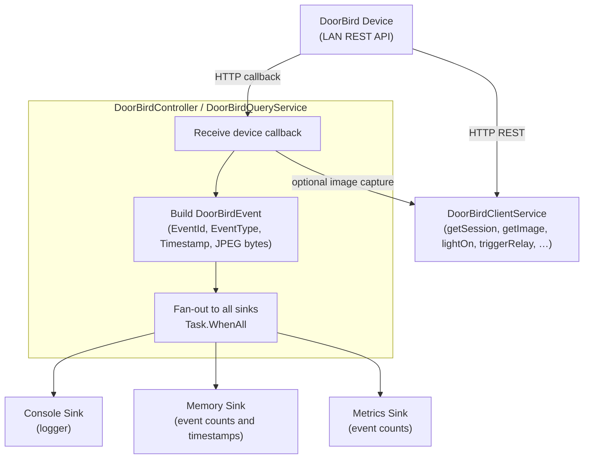

# CasCap.Api.DoorBird

A .NET library that integrates with a [DoorBird](https://www.doorbird.com) IP door station via its local LAN API, captures door events (doorbell, motion, RFID), and dispatches them to configurable sinks.

The integration is validated against a DoorBird D2100E and uses only the model-independent surfaces exposed by the DoorBird LAN API.

## Installation

Targets .NET 8 and .NET 10.

```bash
dotnet add package CasCap.Api.DoorBird
```

## Usage

With the configuration below loaded in a .NET host:

```csharp
using CasCap.Extensions;
using CasCap.Services;
using Microsoft.Extensions.DependencyInjection;
using Microsoft.Extensions.Hosting;

var builder = Host.CreateApplicationBuilder(args);
builder.Services.AddDoorBird(builder.Configuration, lite: true);
using var host = builder.Build();
var imageBytes = await host.Services.GetRequiredService<DoorBirdClientService>().GetImage();
```

This reads one JPEG using device credentials; relay calls change physical access. `lite: true`
omits background services and health checks. Full hosting also needs MVC controller mapping and
the feature-worker runner, as supplied by SmartHaus.

## Events and Audio

The integration is webhook-driven, not polled. `DoorBirdBgService` idles to satisfy the feature
runner contract. Device callbacks reach `DoorBirdController`, which delegates event handling to
`DoorBirdQueryService` and its configured sinks.

A REST API (`DoorBirdController`) exposes real-time photo, MJPEG video stream, relay trigger, and light-on endpoints, as well as event callbacks for push notifications from the device.

`DoorBirdQueryService.CaptureAudio` provides bounded receive-only microphone capture through the
official `bha-api/audio-receive.cgi` endpoint. DoorBird returns raw 8 kHz mono G.711 μ-law audio;
the library frames it as `audio/wav` without transcoding so downstream callers can validate,
normalize, and transcribe it. Capture duration, byte count, and timeout are bounded by
`DoorBirdConfig`.

### Sinks

| Sink | Description |
| --- | --- |
| **Console** | Logs every event via the .NET logger (Debug level) |
| **Memory** | Tracks event counts and timestamps in memory for snapshot queries |
| **Metrics** | Emits event counts via OpenTelemetry metrics |

Optional Redis, Azure Tables, and Azure Blob Storage implementations are provided by
[`CasCap.Api.DoorBird.Sinks`](https://github.com/f2calv/SmartHaus/tree/main/src/CasCap.Api.DoorBird.Sinks).

### Receive-only audio

| Setting | Default | Purpose |
| --- | ---: | --- |
| `AudioReceiveUri` | `bha-api/audio-receive.cgi` | Relative DoorBird microphone endpoint |
| `AudioCaptureMaxDurationSeconds` | `30` | Maximum requested capture duration |
| `AudioCaptureMaxBytes` | `524288` | Maximum returned WAV size |
| `AudioCaptureTimeoutMs` | `45000` | End-to-end capture timeout |

## Event Flow



## Configuration Examples

### Minimal

```json
{
  "CasCap": {
    "DoorBirdConfig": {
      "BaseAddress": "http://device.example.com",
      "Username": "<device-username>",
      "Password": "<device-password>",
      "DoorControllerID": "<controller-id>",
      "DoorControllerRelayID": "<relay-id>",
      "AzureTableStorageConnectionString": "https://example.table.core.windows.net",
      "AzureBlobStorageConnectionString": "https://example.blob.core.windows.net",
      "AzureBlobStorageContainerName": "doorbird-images",
      "Sinks": {
        "AvailableSinks": {
          "Console": { "Enabled": true }
        }
      }
    }
  }
}
```

### Fully configured

```json
{
  "CasCap": {
    "DoorBirdConfig": {
      "BaseAddress": "http://device.example.com",
      "Username": "<device-username>",
      "Password": "<device-password>",
      "DoorControllerID": "<controller-id>",
      "DoorControllerRelayID": "<relay-id>",
      "AzureTableStorageConnectionString": "https://example.table.core.windows.net",
      "AzureBlobStorageConnectionString": "https://example.blob.core.windows.net",
      "AzureBlobStorageContainerName": "doorbird-images",
      "HealthCheckUri": "bha-api/info.cgi",
      "HealthCheck": "Readiness",
      "AudioCaptureMaxDurationSeconds": 30,
      "AudioCaptureMaxBytes": 524288,
      "AudioCaptureTimeoutMs": 45000,
      "Sinks": {
        "AvailableSinks": {
          "Console": { "Enabled": true },
          "Memory": { "Enabled": true },
          "Metrics": { "Enabled": true }
        }
      }
    }
  }
}
```

Storage fields are required by the options model even with only local sinks. Replace synthetic
endpoints only when configuring your own storage.

## License

This project is released under the [MIT License](https://github.com/f2calv/SmartHaus/blob/main/LICENSE).
