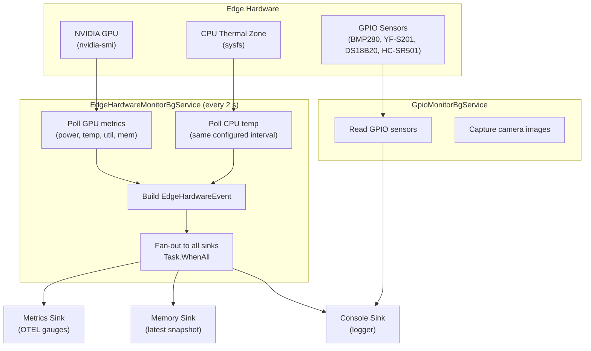

# CasCap.Api.EdgeHardware

Source-only .NET 10 hardware monitoring library for edge applications. It collects NVIDIA GPU and
CPU temperature readings and provides Raspberry Pi GPIO/peripheral services.

## Usage

Enable `EdgeHardware` in SmartHaus's `CasCap:FeatureConfig:EnabledFeatures` and load the configuration
below. The server registers the feature runner, CPU provider, sinks and Pi services.

For a custom host, registration detects the GPU and returns whether one was found:

```csharp
using CasCap.Extensions;

var gpuDetected = builder.Services.AddEdgeHardware(builder.Configuration, cpuEnabled: true);
```

Here `builder` is your .NET host builder. Run the registered [`IBgFeature`](https://github.com/f2calv/CasCap.Common/blob/main/src/CasCap.Common.Abstractions/Abstractions/IBgFeature.cs) worker through the shared
feature runner, and supply the shared [`IKubeAppConfig`](https://github.com/f2calv/CasCap.Common/blob/main/src/CasCap.Common.Abstractions/Abstractions/_IKubeAppConfig.cs)/time services. Use
`AddEdgeHardwareWithExtraSinks` from the [storage extension](../CasCap.Api.EdgeHardware.Sinks/README.md)
when Redis or Azure Tables are needed. This is not a published NuGet package.

## Purpose

### Unified Monitor (`EdgeHardwareMonitorBgService`)

- Periodically invokes `nvidia-smi` to read GPU power draw (W), temperature (°C), compute utilization (%), memory utilization (%) and memory usage (MiB).
- Reads CPU temperature via `Iot.Device.CpuTemperature` (Linux thermal zone) when available.
- Emits `EdgeHardwareEvent` instances to all registered [`IEventSink<EdgeHardwareEvent>`](https://github.com/f2calv/CasCap.Common/blob/main/src/CasCap.Common.Abstractions/Abstractions/IEventSink%7BT%7D.cs) implementations.
- Publishes OpenTelemetry observable gauges via `EdgeHardwareSinkMetricsService`.
- Exposes snapshots through [`IEdgeHardwareQueryService`](https://github.com/f2calv/SmartHaus/blob/main/src/CasCap.Api.EdgeHardware/Abstractions/IEdgeHardwareQueryService.cs).
- GPU detection uses ILGPU at registration; polling attempts `nvidia-smi` and tolerates unavailable GPU data.
- CPU readings require registration with `cpuEnabled: true` (the default is `false`).

### Event Sinks

| Sink | Description |
| --- | --- |
| `EdgeHardwareSinkConsoleService` | Logs each reading at debug level |
| `EdgeHardwareSinkMemoryService` | In-memory latest snapshot, implements [`IEdgeHardwareQuery`](https://github.com/f2calv/SmartHaus/blob/main/src/CasCap.Api.EdgeHardware/Abstractions/IEdgeHardwareQuery.cs) |
| `EdgeHardwareSinkMetricsService` | Publishes OTEL gauges (`gpu.power`, `gpu.temperature`, `gpu.utilization`, `gpu.memory.used`, `hw.temperature`) |

### GPIO Sensors (`GpioMonitorBgService`)

- Manages GPIO-attached sensor devices on Raspberry Pi hardware.
- **`GpioBmp280SensorService`** – Reads temperature and barometric pressure from a BMP280 sensor over I²C.
- **`GpioYfS201SensorService`** – Counts pulses from a YF-S201 water-flow sensor to derive flow rate.
- Gated behind the `EdgeHardware` feature flag.

### Supported Devices

| Device service | Hardware | Interface |
| --- | --- | --- |
| `CpuTemperatureService` | Built-in CPU thermal sensor | sysfs via `Iot.Device.CpuTemperature` |
| `GpioBmp280SensorService` | BMP280 temperature & pressure | I²C |
| `GpioYfS201SensorService` | YF-S201 water-flow sensor | GPIO pulse counting |
| `GpioDs18B20SensorService` | DS18B20 waterproof temperature | 1-Wire |
| `GpioHcsr501SensorService` | HC-SR501 PIR motion sensor | GPIO |
| `GpioLedControllerService` | LED indicator | GPIO |
| `PiCameraDeviceService` | Raspberry Pi Camera Module | MMAL / MMALSharp |

## Event Flow



## Platform Support

NVIDIA readings need a working driver and `nvidia-smi` accessible to the process. CPU temperature
uses IoT thermal bindings on Linux; the Windows provider is compiled only for a Windows-targeted
build. The default project target is `net10.0`, so do not assume Windows hardware sensor support
from that artifact. Raspberry Pi GPIO, I²C, 1-Wire and MMAL camera services require compatible
hardware, native libraries and device permissions; they are not portable desktop implementations.
The GPIO worker also has a fixed node-name gate in source, so feature configuration alone does
not enable its sensor loop on an arbitrary Raspberry Pi.

### Pi registration

```csharp
// GPIO sensors & Pi peripherals
builder.Services.AddEdgeHardwarePi(builder.Configuration);
```

## Configuration

Edge hardware monitoring reads from the `CasCap:EdgeHardwareConfig` configuration section:

| Setting | Type | Default | Description |
| --- | --- | --- | --- |
| `PollIntervalMs` | `int` | `2000` | Milliseconds between nvidia-smi GPU metric reads |
| `EnergyPerKiloTokenWh` | `double` | `0.003` | Fallback Wh per 1 000 tokens when live GPU data unavailable |
| `KettleBoilWh` | `double` | `100` | Reference energy for a kettle boil |
| `PhoneChargeWh` | `double` | `15` | Reference energy for a phone charge |
| `LedBulbHourWh` | `double` | `10` | Reference energy for one LED-bulb hour |
| `Sinks` | `SinkConfig` | *(required)* | Event sink configuration (Console, Memory, Metrics, etc.) |

Raspberry Pi reads from `CasCap:EdgeHardwareConfig`:

| Setting | Type | Default | Description |
| --- | --- | --- | --- |
| `LocalPath` | `string` | *(required)* | Filesystem path for camera captures |
| `Sensors.HcSr501.OutPin` | `int` | `0` | GPIO pin for HC-SR501 motion sensor |

## Configuration Examples

### Minimal

```json
{
  "CasCap": {
    "EdgeHardwareConfig": {
      "AzureTableStorageConnectionString": "https://<account>.table.core.windows.net",
      "Sinks": {
        "AvailableSinks": {
          "Console": { "Enabled": true },
          "Metrics": { "Enabled": true }
        }
      }
    }
  }
}
```

### Fully configured

```json
{
  "CasCap": {
    "EdgeHardwareConfig": {
      "PollIntervalMs": 2000,
      "LocalPath": "./captures",
      "EnergyPerKiloTokenWh": 0.003,
      "KettleBoilWh": 100,
      "PhoneChargeWh": 15,
      "LedBulbHourWh": 10,
      "AzureTableStorageConnectionString": "https://<account>.table.core.windows.net",
      "HealthCheckAzureTableStorage": "None",
      "Sensors": {
        "HcSr501": { "OutPin": 16 }
      },
      "Sinks": {
        "AvailableSinks": {
          "Console": { "Enabled": true },
          "Memory": { "Enabled": true },
          "Metrics": { "Enabled": true },
          "AzureTables": { "Enabled": true },
          "Redis": {
            "Enabled": true,
            "Settings": {
              "SnapshotValues": "edgehardware:snapshot:values",
              "SeriesValues": "edgehardware:series"
            }
          }
        }
      }
    }
  }
}
```

## Dependencies

### NuGet packages

| Package | Purpose |
| --- | --- |
| [Iot.Device.Bindings](https://www.nuget.org/packages/iot.device.bindings) | GPIO, I²C, 1-Wire, CPU temperature bindings |
| [ILGPU](https://www.nuget.org/packages/ilgpu) | GPU compute (experimental) |
| [LibreHardwareMonitorLib](https://www.nuget.org/packages/librehardwaremonitorlib) | Hardware sensor monitoring (Windows) |
| [MMALSharp](https://www.nuget.org/packages/mmalsharp) | Raspberry Pi camera capture |
| [MMALSharp.FFmpeg](https://www.nuget.org/packages/mmalsharp.ffmpeg) | FFmpeg helpers for MMALSharp |
| [Asp.Versioning.Mvc](https://www.nuget.org/packages/asp.versioning.mvc) | API versioning |
| [Microsoft.AspNetCore.Mvc.Core](https://www.nuget.org/packages/microsoft.aspnetcore.mvc.core) | MVC core for REST controllers |
| [Microsoft.Extensions.Http](https://www.nuget.org/packages/microsoft.extensions.http) | `HttpClient` factory |
| [Microsoft.Extensions.Diagnostics.HealthChecks](https://www.nuget.org/packages/microsoft.extensions.diagnostics.healthchecks) | Health check abstractions |
| [CasCap.Common.Extensions](https://www.nuget.org/packages/cascap.common.extensions) | Shared extension helpers |
| [CasCap.Common.Logging](https://www.nuget.org/packages/cascap.common.logging) | Structured logging helpers |
| [CasCap.Common.Net](https://www.nuget.org/packages/cascap.common.net) | HTTP client helpers |
| [CasCap.Common.Serialization.Json](https://www.nuget.org/packages/cascap.common.serialization.json) | JSON serialisation helpers |
| [CasCap.Common.Configuration](https://www.nuget.org/packages/cascap.common.configuration) | Configuration binding helpers |
| [CasCap.Common.Extensions.Diagnostics.HealthChecks](https://www.nuget.org/packages/cascap.common.extensions.diagnostics.healthchecks) | Kubernetes probe tag helpers |

### Project references

| Project | Purpose |
| --- | --- |

## License

This project is released under the [MIT License](../../LICENSE). See the [LICENSE](../../LICENSE) file for details.
