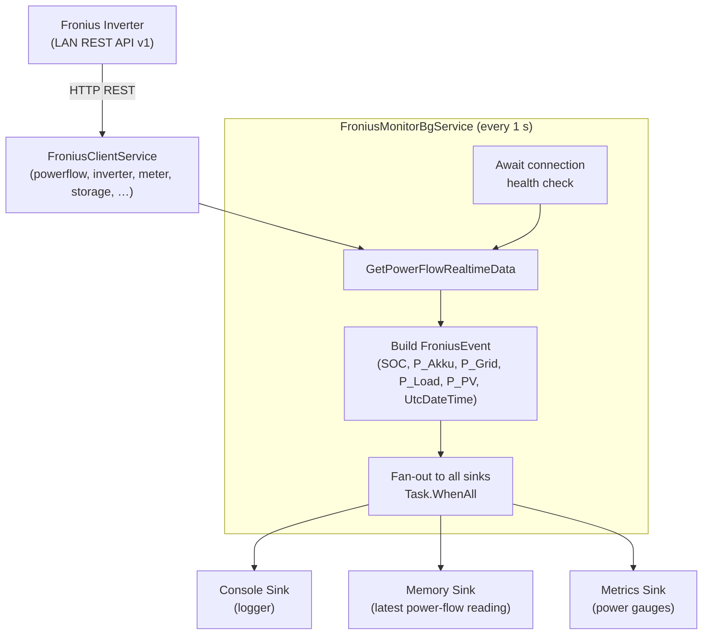

# CasCap.Api.Fronius

A .NET library that integrates with a [Fronius](https://www.fronius.com) solar inverter (Symo Gen24) via its local Solar API v1, samples power-flow data every second, and dispatches each reading to configurable sinks.

## Installation

Targets .NET 8 and .NET 10.

```bash
dotnet add package CasCap.Api.Fronius
```

## Usage

Load the JSON configuration below in a .NET host and read a live power-flow response:

```csharp
using CasCap.Extensions;
using CasCap.Services;
using Microsoft.Extensions.DependencyInjection;
using Microsoft.Extensions.Hosting;

var builder = Host.CreateApplicationBuilder(args);
builder.Services.AddFronius(builder.Configuration, lite: true);
using var host = builder.Build();
var response = await host.Services.GetRequiredService<FroniusClientService>()
    .GetPowerFlowRealtimeData();
```

Enable Solar API access on the inverter and substitute its LAN URL. `lite: true` supports direct
queries without monitoring. For continuous collection, use full registration and start its
[`IBgFeature`](https://github.com/f2calv/CasCap.Common/blob/main/src/CasCap.Common.Abstractions/Abstractions/IBgFeature.cs) workers with `AddFeatureFlagService`, as the SmartHaus host does.

## Monitoring

The library is built around one background service that forms the core pipeline:

**`FroniusMonitorBgService`** waits for the device health check, then polls
`GetPowerFlowRealtimeData` every second by default. Each response becomes a `FroniusEvent`
containing SOC, P_Akku, P_Grid, P_Load, P_PV and a UTC timestamp. Events are dispatched to all
registered sinks in parallel; the Metrics sink owns OpenTelemetry gauges.

A REST API (`FroniusController`) exposes endpoints for real-time power flow, inverter data, meter readings, storage state, and historical line items.

### Sinks

| Sink | Description |
| --- | --- |
| **Console** | Logs every event via the .NET logger (Debug level) |
| **Memory** | Tracks the latest power-flow reading in memory for snapshot queries |
| **Metrics** | Emits power and percentage gauges via OpenTelemetry metrics |

Optional Redis and Azure Tables implementations are provided by
[`CasCap.Api.Fronius.Sinks`](https://github.com/f2calv/SmartHaus/tree/main/src/CasCap.Api.Fronius.Sinks).

## Event Flow



## Configuration Examples

### Minimal

```json
{
  "CasCap": {
    "FroniusConfig": {
      "BaseAddress": "http://inverter.example.com",
      "AzureTableStorageConnectionString": "https://example.table.core.windows.net",
      "Sinks": {
        "AvailableSinks": {
          "Console": { "Enabled": true },
          "Metrics": { "Enabled": true }
        }
      }
    }
  }
}
```

### Fully configured

```json
{
  "CasCap": {
    "FroniusConfig": {
      "BaseAddress": "http://inverter.example.com",
      "AzureTableStorageConnectionString": "https://example.table.core.windows.net",
      "HealthCheckUri": "solar_api/v1/GetPowerFlowRealtimeData.fcgi",
      "HealthCheck": "Readiness",
      "PollingIntervalMs": 1000,
      "ConnectionPollingDelayMs": 1000,
      "ConnectionLogEscalationInterval": 10,
      "SocAlertThreshold": 0.95,
      "SocAlertHysteresis": 0.05,
      "SocAlertCooldownMs": 300000,
      "Sinks": {
        "AvailableSinks": {
          "Console": { "Enabled": true },
          "Memory": { "Enabled": true },
          "Metrics": { "Enabled": true }
        }
      }
    }
  }
}
```

The storage endpoint is required by the options model even when only local sinks are selected.

## License

This project is released under the [MIT License](https://github.com/f2calv/SmartHaus/blob/main/LICENSE).
