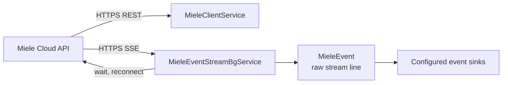

# CasCap.Api.Miele

A .NET client for the Miele 3rd Party Cloud API, with appliance queries, control commands and a
server-sent event (SSE) reader. This source-only library targets .NET 10 and is not packaged for NuGet.

## Usage

In SmartHaus, enable `Miele` in `CasCap:FeatureConfig:EnabledFeatures` and supply the configuration
below. Custom hosts can register the library and query devices:

```csharp
using CasCap.Extensions;
using CasCap.Services;
using Microsoft.Extensions.DependencyInjection;
using Microsoft.Extensions.Hosting;

var builder = Host.CreateApplicationBuilder(args);
builder.Services.AddMiele(builder.Configuration);
using var host = builder.Build();
var devices = await host.Services.GetRequiredService<MieleClientService>().GetDevices();
```

The client also exposes `GetDevice`, `GetIdent`, `GetState`, `GetActions` and `GetPrograms`.
`PutAction` and `PutProgram` change appliance state using
[`MieleActionRequest`](Models/Dtos/MieleActionRequest.cs) and
[`MieleProgramRequest`](Models/Dtos/MieleProgramRequest.cs). Requests use the bearer token in `OAuthToken`;
the library does not acquire or refresh tokens. Obtain and rotate them outside the application.

## Commands and Failures

All nine operations on [`IMieleQueryService`](Abstractions/IMieleQueryService.cs) accept cancellation,
forwarded through the HTTP controller and appliance MCP facade to the provider. Read methods return
`null` only for provider HTTP 404; empty or malformed successful responses and other unsuccessful
statuses throw [`MieleApiException`](Exceptions/MieleApiException.cs).

Commands return `MieleCommandResult.Accepted`, `Rejected` or `NotFound`. Provider HTTP 400, 405,
409 and 422 mean rejection; HTTP 404 means absence. Authentication, rate-limit, transport, timeout
and other provider failures throw the domain exception. Caller cancellation propagates unchanged.
The named REST client's automatic retries are disabled for both reads and writes: an appliance PUT
may start a program, so replaying an outcome-uncertain command is unsafe.

The application HTTP contract is:

| Outcome | HTTP response |
| --- | --- |
| Successful read | 200 with the typed device/action/program payload |
| Accepted command | 200 with `true` |
| Missing resource | 404 |
| Invalid request body | 400 Validation Problem Details, without a provider call |
| Provider rejects a command | 400 with a sanitized rejection string |
| Provider failure | 502 Problem Details, without provider content or identifiers |

Command bodies reject unknown fields and are validated before dispatch, including direct client
and MCP calls. Optional fields are omitted rather than sent as JSON null. An action requires at
least one supported field; program selection requires an explicit `programId`. Temperature and
program identifiers remain appliance-specific rather than imposing guessed bounds.

```json
{"processAction":1}
```

```json
{"programId":24,"duration":[1,15],"temperature":220}
```

These are illustrative commands, not instructions to run them against an appliance. Obtain
currently supported actions and programs before selecting values.

The request contracts were checked against the official
[Miele API specification, version 1.1.0](https://developer.miele.com/docs/third-party-api/swagger.json).
`runOnTime` is deliberately unsupported: the schema describes an integer array while its request
example uses a scalar. Both forms are rejected until the provider contract is clarified.

## Event Flow

Starting `MieleEventStreamBgService` requires the host's [`IBgFeature`](https://github.com/f2calv/CasCap.Common/blob/main/src/CasCap.Common.Abstractions/Abstractions/IBgFeature.cs) runner and health-check
execution, as provided by SmartHaus. Each nonblank stream line becomes a `MieleEvent` with
`DeviceId = "unknown"`, `EventType = StatusUpdate` and the raw line. It is not decoded into an
appliance-specific event. Completion or an HTTP failure is followed by the configured reconnect delay.



Console and Memory sink types exist, but `AddMiele` does not scan the core assembly for them.
Selecting those names in configuration alone does not register a sink. Use
[CasCap.Api.Miele.Sinks](../CasCap.Api.Miele.Sinks/README.md) to register Redis or Azure Tables,
or register a core sink explicitly in a custom host.

## Configuration

Configuration section: `CasCap:MieleConfig`.

| Setting | Default | Purpose |
| --- | --- | --- |
| `OAuthToken` | Required | Existing Miele OAuth bearer token |
| `HealthCheckUri` | `https://api.mcs3.miele.com/v1/` | REST base address and readiness probe |
| `HealthCheckExpectedHttpStatusCodes` | `[404]` | Status codes accepted by the connectivity probe |
| `HealthCheck` | `Readiness` | Probe tag |
| `ConnectionPollingDelayMs` | `1000` | Delay while waiting for readiness |
| `ConnectionLogEscalationInterval` | `10` | Readiness logging escalation interval |
| `EventStreamUrl` | `https://api.mcs3.miele.com/v1/devices/all/events` | SSE endpoint |
| `EventStreamReconnectDelayMs` | `60000` | Delay after stream completion or HTTP failure |
| `Sinks` | Required | Enabled sink definitions |
| `RedisSeriesExpiryDays` | `7` | Redis series retention |

## Configuration Examples

### Minimal

```json
{
  "CasCap": {
    "MieleConfig": {
      "OAuthToken": "<oauth-token>",
      "Sinks": { "AvailableSinks": { "Console": { "Enabled": true } } }
    }
  }
}
```

### Stream and storage settings

```json
{
  "CasCap": {
    "MieleConfig": {
      "OAuthToken": "<oauth-token>",
      "HealthCheckUri": "https://api.mcs3.miele.com/v1/",
      "HealthCheckExpectedHttpStatusCodes": [404],
      "HealthCheck": "Readiness",
      "EventStreamUrl": "https://api.mcs3.miele.com/v1/devices/all/events",
      "EventStreamReconnectDelayMs": 60000,
      "AzureTableStorageConnectionString": "https://example.table.core.windows.net",
      "Sinks": {
        "AvailableSinks": {
          "Console": { "Enabled": true },
          "Redis": { "Enabled": true }
        }
      }
    }
  }
}
```

Redis requires the extra-sinks package's registration and a configured cache connection; the
synthetic storage endpoint alone does not configure Azure authentication.

## License

[MIT License](../../LICENSE).
