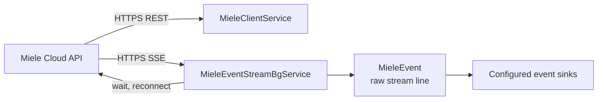

# CasCap.Api.Miele

A .NET client for the Miele 3rd Party Cloud API, with appliance queries, control commands and a
server-sent event (SSE) reader. This source-only library targets .NET 10 and is not packaged for NuGet.

## Usage

In SmartHaus, enable `Miele` in `CasCap:FeatureConfig:EnabledFeatures` and supply the configuration
below. Custom hosts can register the library and query devices:

```csharp
using CasCap.Extensions;
using CasCap.Services;
using Microsoft.Extensions.DependencyInjection;
using Microsoft.Extensions.Hosting;

var builder = Host.CreateApplicationBuilder(args);
builder.Services.AddMiele(builder.Configuration);
using var host = builder.Build();
var devices = await host.Services.GetRequiredService<MieleClientService>().GetDevices();
```

The client also exposes `GetDevice`, `GetIdent`, `GetState`, `GetActions` and `GetPrograms`.
`PutAction` and `PutProgram` change appliance state. Requests use the bearer token in `OAuthToken`;
the library does not acquire or refresh tokens. Obtain and rotate them outside the application.

## Event Flow

Starting `MieleEventStreamBgService` requires the host's [`IBgFeature`](https://github.com/f2calv/CasCap.Common/blob/main/src/CasCap.Common.Abstractions/Abstractions/IBgFeature.cs) runner and health-check
execution, as provided by SmartHaus. Each nonblank stream line becomes a `MieleEvent` with
`DeviceId = "unknown"`, `EventType = StatusUpdate` and the raw line. It is not decoded into an
appliance-specific event. Completion or an HTTP failure is followed by the configured reconnect delay.



Console and Memory sink types exist, but `AddMiele` does not scan the core assembly for them.
Selecting those names in configuration alone does not register a sink. Use
[CasCap.Api.Miele.Sinks](../CasCap.Api.Miele.Sinks/README.md) to register Redis or Azure Tables,
or register a core sink explicitly in a custom host.

## Configuration

Configuration section: `CasCap:MieleConfig`.

| Setting | Default | Purpose |
| --- | --- | --- |
| `OAuthToken` | Required | Existing Miele OAuth bearer token |
| `HealthCheckUri` | `https://api.mcs3.miele.com/v1/` | REST base address and readiness probe |
| `HealthCheckExpectedHttpStatusCodes` | `[404]` | Status codes accepted by the connectivity probe |
| `HealthCheck` | `Readiness` | Probe tag |
| `ConnectionPollingDelayMs` | `1000` | Delay while waiting for readiness |
| `ConnectionLogEscalationInterval` | `10` | Readiness logging escalation interval |
| `EventStreamUrl` | `https://api.mcs3.miele.com/v1/devices/all/events` | SSE endpoint |
| `EventStreamReconnectDelayMs` | `60000` | Delay after stream completion or HTTP failure |
| `Sinks` | Required | Enabled sink definitions |
| `RedisSeriesExpiryDays` | `7` | Redis series retention |

## Configuration Examples

### Minimal

```json
{
  "CasCap": {
    "MieleConfig": {
      "OAuthToken": "<oauth-token>",
      "Sinks": { "AvailableSinks": { "Console": { "Enabled": true } } }
    }
  }
}
```

### Stream and storage settings

```json
{
  "CasCap": {
    "MieleConfig": {
      "OAuthToken": "<oauth-token>",
      "HealthCheckUri": "https://api.mcs3.miele.com/v1/",
      "HealthCheckExpectedHttpStatusCodes": [404],
      "HealthCheck": "Readiness",
      "EventStreamUrl": "https://api.mcs3.miele.com/v1/devices/all/events",
      "EventStreamReconnectDelayMs": 60000,
      "AzureTableStorageConnectionString": "https://example.table.core.windows.net",
      "Sinks": {
        "AvailableSinks": {
          "Console": { "Enabled": true },
          "Redis": { "Enabled": true }
        }
      }
    }
  }
}
```

Redis requires the extra-sinks package's registration and a configured cache connection; the
synthetic storage endpoint alone does not configure Azure authentication.

## License

[MIT License](../../LICENSE).
