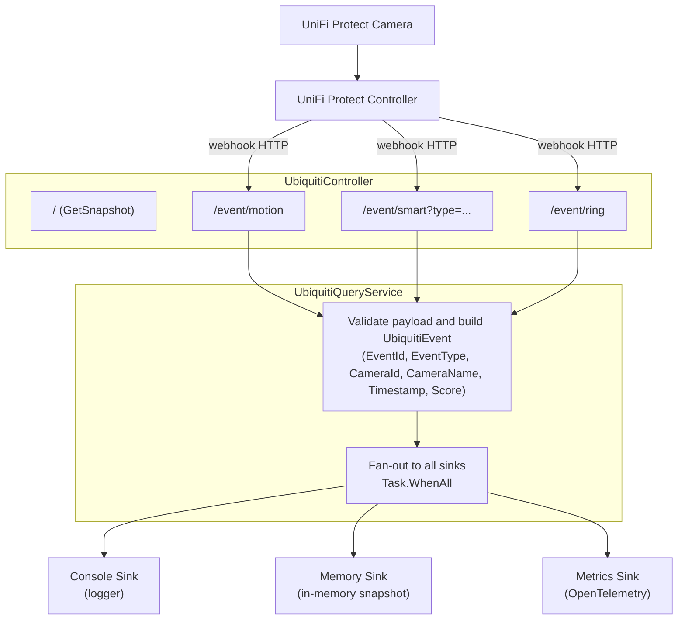

# CasCap.Api.Ubiquiti

A .NET library that integrates with [Ubiquiti UniFi Protect](https://ui.com/camera-security) IP cameras via webhook callbacks, captures camera events (motion detection, smart detection, doorbell ring), and fans them out to a configurable set of sinks for storage and streaming.

## Purpose

This source-only .NET 10 library is not published as a NuGet package.

## Usage

Enable `Ubiquiti` in SmartHaus's `CasCap:FeatureConfig:EnabledFeatures` and supply the configuration
below. Custom ASP.NET Core hosts use `services.AddUbiquiti(configuration)` from `CasCap.Extensions`
and map the library's controllers alongside the host's API versioning.

For a running local demo, submit a synthetic event:

```bash
curl -X POST "http://localhost:8080/api/v1.0/ubiquiti/event/smart?type=person&camera_name=ExampleCamera&score=0.95"
```

The callback returns `ok` and writes to the configured sinks. Motion, smart-detection and ring
callbacks accept GET or POST and allow anonymous requests; restrict their network exposure.
Smart-detection types are `person`, `vehicle`, `animal` and `package`.

## Webhooks

The library is built around webhook endpoints that form the core pipeline:

**`UbiquitiController`** – Exposes a `GET /` snapshot query endpoint and REST API webhook endpoints (`/event/motion`, `/event/smart?type=person|vehicle|animal|package`, `/event/ring`) that the UniFi Protect controller or third-party automation tools call when events occur.
The controller delegates to
[`IUbiquitiQueryService`](./Abstractions/IUbiquitiQueryService.cs), which validates the detection
type, decodes the optional thumbnail and constructs each `UbiquitiEvent` before dispatching to
every registered [`IEventSink<UbiquitiEvent>`](https://github.com/f2calv/CasCap.Common/blob/main/src/CasCap.Common.Abstractions/Abstractions/IEventSink%7BT%7D.cs).
The service returns `UbiquitiWebhookResult`; invalid detection types or malformed thumbnail/timestamp
values become HTTP 400 string responses. Automatic binding errors use validation Problem Details.
Sink failures are not reclassified as caller errors, and cancellation propagates through all
webhooks, including doorbell rings. All payload parsing finishes before any sink receives an event.

### Sinks

| Sink | Description |
| --- | --- |
| **Console** | Logs every event via the .NET logger (Debug level) |
| **Memory** | Tracks event counts and timestamps in-memory per event type; provides snapshot queries |
| **Metrics** | Publishes event counts as OpenTelemetry gauge metrics |

Optional Redis and Azure Tables implementations are provided by
[`CasCap.Api.Ubiquiti.Sinks`](../CasCap.Api.Ubiquiti.Sinks).

UniFi Protect Alarm Manager POST payloads can include a base64-encoded thumbnail under
`alarm.thumbnail`. The library exposes decoded thumbnail bytes on the event model without defining
how an application stores, analyzes, or publishes them. Thumbnail bytes are never logged or
serialized into event metadata.

## Event Flow



## Configuration Examples

### Minimal

```json
{
  "CasCap": {
    "UbiquitiConfig": {
      "BaseAddress": "https://controller.example.com",
      "Username": "<controller-username>",
      "Password": "<controller-password>",
      "AzureTableStorageConnectionString": "https://example.table.core.windows.net",
      "Sinks": {
        "AvailableSinks": {
          "Console": { "Enabled": true },
          "Memory": { "Enabled": true }
        }
      }
    }
  }
}
```

### Fully configured

```json
{
  "CasCap": {
    "UbiquitiConfig": {
      "BaseAddress": "https://controller.example.com",
      "AzureTableStorageConnectionString": "https://example.table.core.windows.net",
      "Username": "<controller-username>",
      "Password": "<controller-password>",
      "Sinks": {
        "AvailableSinks": {
          "Console": { "Enabled": true },
          "Memory": { "Enabled": true },
          "Metrics": { "Enabled": true }
        }
      }
    }
  }
}
```

## Dependencies

### NuGet packages

| Package | Purpose |
| --- | --- |
| `KoenZomers.UniFi.Api` | UniFi controller API client for future tighter integration |
| `Asp.Versioning.Mvc` | API versioning |
| `Microsoft.AspNetCore.Http.Abstractions` | HTTP abstractions |
| `Microsoft.AspNetCore.Mvc.Core` | MVC core for REST controllers |
| `Microsoft.Extensions.Http` | `HttpClient` factory |
| `CasCap.Common.Caching` | Distributed caching abstractions |
| `CasCap.Common.Configuration` | Configuration binding helpers |
| `CasCap.Common.Extensions` | Common extension methods and sink infrastructure |
| `CasCap.Common.Logging` | Structured logging helpers |
| `CasCap.Common.Net` | HTTP client base classes |
| `CasCap.Common.Extensions.Diagnostics.HealthChecks` | Kubernetes probe tag helpers |
| `Microsoft.Extensions.Diagnostics.HealthChecks` | Health check abstractions |

## License

This project is released under the [MIT License](../../LICENSE). See the [LICENSE](../../LICENSE) file for details.
