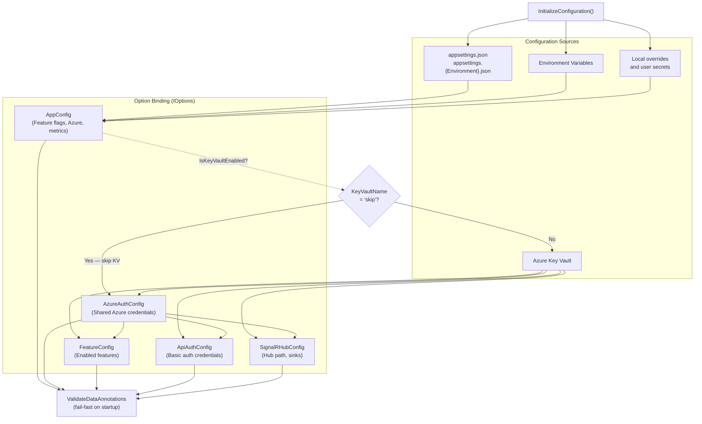

# CasCap.App

Shared bootstrap library that provides configuration initialization for all application hosts (`CasCap.App.Server` and `CasCap.App.Console`). This project is a library — not an executable — that centralizes the configuration and DI wiring common to every entry point.

This source-only library targets .NET 10 and is not a NuGet package.

## Usage

The server and console invoke the same bootstrap before composing their own services:

```csharp
using CasCap.Extensions;
using Microsoft.Extensions.Hosting;
using System.Reflection;

var builder = Host.CreateApplicationBuilder(args);
var (appConfig, apiAuthConfig, enabledFeatures, metadata) =
    builder.InitializeConfiguration(Assembly.GetExecutingAssembly());
```

The entry assembly determines the user-secrets store and application metadata. Supply the tracked
base settings and private overrides through configuration, not embedded credentials.

## Purpose

The single `HostApplicationBuilderExtensions.InitializeConfiguration` extension method performs the full configuration bootstrap sequence:

1. Adds standard configuration sources via `AddStandardConfiguration` (appsettings, environment variables, user secrets).
2. Binds `AppConfig` to extract Key Vault connection details.
3. If `IsKeyVaultEnabled` is `true`, adds Azure Key Vault as a configuration source (skipped when `KeyVaultName = "skip"`).
4. Re-binds `AppConfig` with the newly available Key Vault secrets (or the original sources when Key Vault is skipped).
5. Binds and registers the shared strongly-typed options needed by both application hosts.

### Registered Options

| Section | Type | Description |
| --- | --- | --- |
| `AppConfig` | `AppConfig` | Master application settings (feature flags, Azure, metrics, sensors) |
| `CasCap:AzureAuthConfig` | `AzureAuthConfig` | Shared Azure credential settings |
| `CasCap:FeatureConfig` | `FeatureConfig` | Enabled application feature names |
| `CasCap:ApiAuthConfig` | `ApiAuthConfig` | Basic authentication credentials for the REST API |
| `CasCap:SignalRHubConfig` | `SignalRHubConfig` | SignalR hub path and sink configuration |

All option sections use `AddOptionsWithValidateOnStart` with `ValidateDataAnnotations` for fail-fast validation.

### Configuration precedence

Later providers override earlier values:

1. Required `appsettings.json` and optional `appsettings.{Environment}.json`.
2. Optional `appsettings.Local.json` and `appsettings.Local.{Environment}.json`.
3. Optional `appsettings.Tests.Local.json` (used by test projects).
4. User secrets from the entry assembly.
5. Environment variables.
6. Azure Key Vault, when enabled.

The standard chain is appended to the host configuration. Do not assume command-line arguments
override providers added afterward.

## Configuration Examples

Merge this local fragment with the base application configuration:

```json
{
  "AppConfig": { "KeyVaultName": "skip" },
  "CasCap": {
    "FeatureConfig": { "EnabledFeatures": "Ubiquiti" }
  }
}
```

For multiple features, use a comma-separated string such as `Fronius,Ubiquiti`. Each selected
integration still needs its own complete options. Configuration fragments are not standalone
application settings.

### Azure authentication

Key Vault access needs Azure credentials with read access. Supply certificate configuration and
real identifiers only through private providers. The shared
[Azure authentication library](https://github.com/f2calv/CasCap.Api.Azure/tree/main/src/CasCap.Api.Azure.Auth)
documents the supported credential forms. `KeyVaultName = "skip"` disables this bootstrap's vault
provider; it does not disable credentials used by other integrations.

## Configuration Hierarchy

Configuration initialization flow and option binding:



## Dependencies

### Project references

| Project | Purpose |
| --- | --- |
| `CasCap.Backend` | Core orchestration and SignalR hub configuration |
| `CasCap.Common.Configuration` | `AddStandardConfiguration` and `AddKeyVaultConfiguration` helpers |
| `CasCap.Common.Extensions.Diagnostics.HealthChecks` | Kubernetes probe tag helpers |

## License

This project is released under the [MIT License](../../LICENSE). See the [LICENSE](../../LICENSE) file for details.
